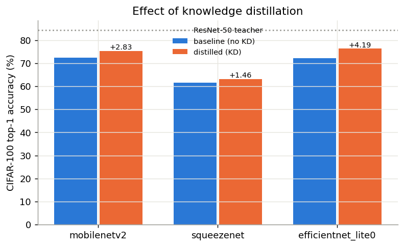
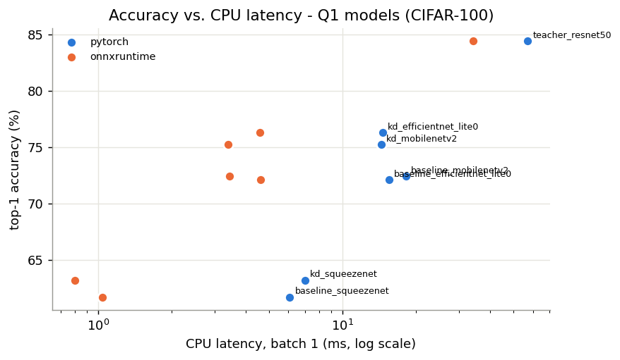
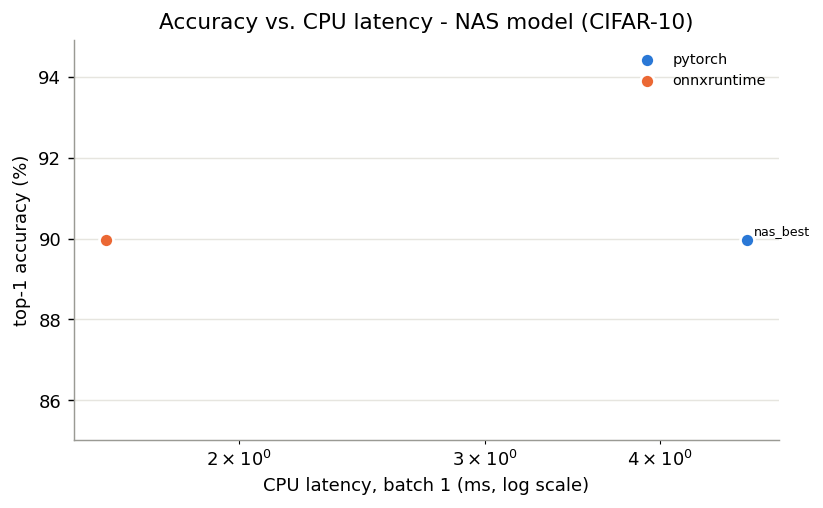
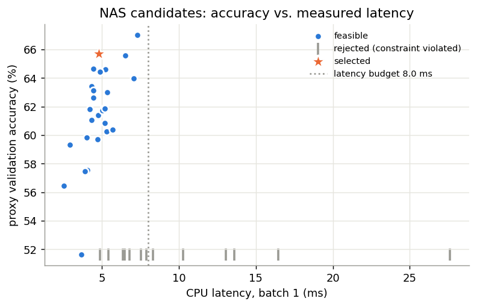
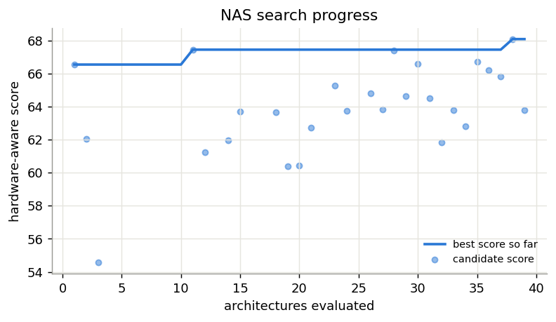
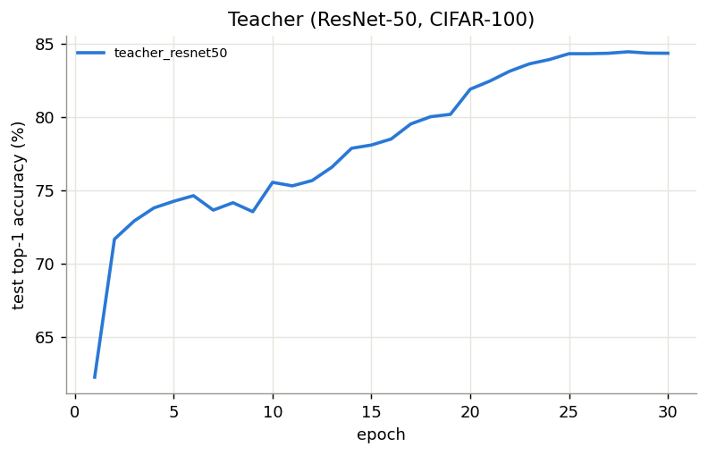
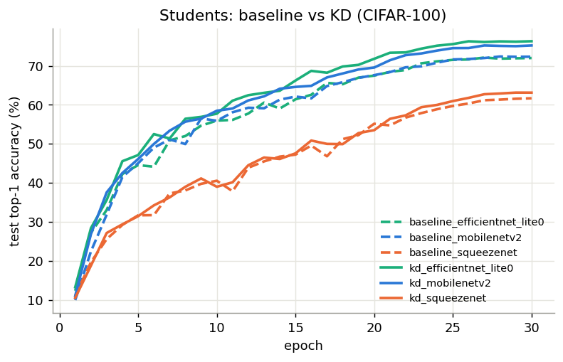
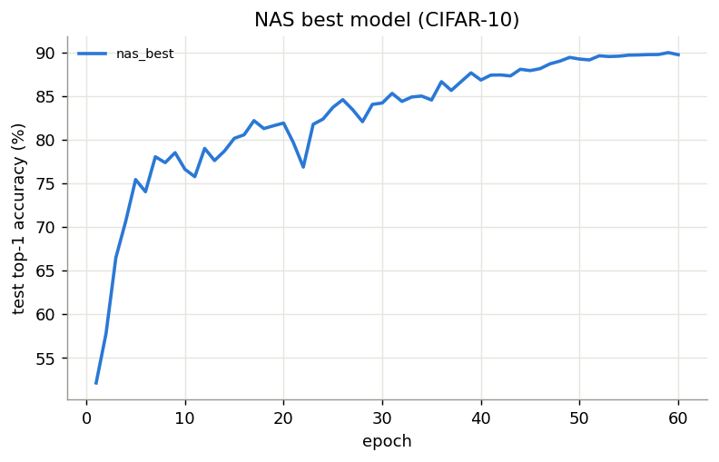

# Experimental results summary

## Q1 - Knowledge distillation vs. baseline

| student | baseline_acc | kd_acc | kd_gain_pts | params_m | size_mb | pytorch_latency_ms | onnx_latency_ms | teacher_acc | compression_x | speedup_vs_teacher_x |
|---|---|---|---|---|---|---|---|---|---|---|
| mobilenetv2 | 72.39 | 75.22 | 2.83 | 2.35 | 9.20 | 14.40 | 3.39 | 84.43 | 9.86 | 3.97 |
| squeezenet | 61.68 | 63.14 | 1.46 | 0.78 | 3.05 | 7.00 | 0.80 | 84.43 | 29.74 | 8.15 |
| efficientnet_lite0 | 72.12 | 76.31 | 4.19 | 3.50 | 13.60 | 14.57 | 4.59 | 84.43 | 6.67 | 3.92 |

## Benchmark (CPU)

| model | runtime | batch_size | top1_acc | params_m | pytorch_size_mb | onnx_size_mb | latency_mean_ms | latency_p95_ms | throughput_img_s | peak_mem_mb |
|---|---|---|---|---|---|---|---|---|---|---|
| baseline_efficientnet_lite0 | pytorch | 1 | 72.12 | 3.50 | 13.60 | 13.30 | 15.47 | 21.66 | 64.63 | 12.27 |
| baseline_efficientnet_lite0 | onnxruntime | 1 | 72.12 | 3.50 | 13.60 | 13.30 | 4.62 | 5.97 | 216.42 | 50.64 |
| baseline_mobilenetv2 | pytorch | 1 | 72.39 | 2.35 | 9.20 | 8.94 | 18.15 | 21.24 | 55.11 | 12.28 |
| baseline_mobilenetv2 | onnxruntime | 1 | 72.39 | 2.35 | 9.20 | 8.94 | 3.43 | 3.92 | 291.44 | 38.15 |
| baseline_squeezenet | pytorch | 1 | 61.68 | 0.78 | 3.05 | 2.96 | 6.07 | 7.93 | 164.77 | 5.62 |
| baseline_squeezenet | onnxruntime | 1 | 61.68 | 0.78 | 3.05 | 2.96 | 1.04 | 1.24 | 962.95 | 20.08 |
| kd_efficientnet_lite0 | pytorch | 1 | 76.31 | 3.50 | 13.60 | 13.30 | 14.57 | 16.49 | 68.62 | 12.21 |
| kd_efficientnet_lite0 | onnxruntime | 1 | 76.31 | 3.50 | 13.60 | 13.30 | 4.59 | 5.83 | 217.66 | 50.55 |
| kd_mobilenetv2 | pytorch | 1 | 75.22 | 2.35 | 9.20 | 8.94 | 14.40 | 17.39 | 69.44 | 12.16 |
| kd_mobilenetv2 | onnxruntime | 1 | 75.22 | 2.35 | 9.20 | 8.94 | 3.39 | 3.74 | 294.66 | 38.03 |
| kd_squeezenet | pytorch | 1 | 63.14 | 0.78 | 3.05 | 2.96 | 7.00 | 9.62 | 142.80 | 5.56 |
| kd_squeezenet | onnxruntime | 1 | 63.14 | 0.78 | 3.05 | 2.96 | 0.80 | 0.92 | 1248.32 | 19.58 |
| nas_best | pytorch | 1 | 89.97 | 0.26 | 1.05 | 1.00 | 4.62 | 5.44 | 216.42 | 13.27 |
| nas_best | onnxruntime | 1 | 89.97 | 0.26 | 1.05 | 1.00 | 1.61 | 1.77 | 622.78 | 14.98 |
| teacher_resnet50 | pytorch | 1 | 84.43 | 23.71 | 90.73 | 90.35 | 57.10 | 64.65 | 17.51 | 21.88 |
| teacher_resnet50 | onnxruntime | 1 | 84.43 | 23.71 | 90.73 | 90.35 | 34.10 | 39.28 | 29.32 | 251.79 |

## Q2 - NAS search

Evaluated **40** architectures: **27** feasible, **13** rejected by deployment constraints.

Top-10 feasible architectures:

| index | arch | latency_mean_ms | size_mb | peak_mem_mb | params_m | val_acc | score |
|---|---|---|---|---|---|---|---|
| 38 | r24 s32 | mbconv3x24k5e4-relu6 | mbconv2x128k5e4-relu6 | h512 | 4.79 | 1.05 | 14.23 | 0.26 | 65.70 | 68.10 |
| 11 | r24 s16 | mbconv3x96k3e2-hswish | conv1x48k7-hswish | mbconv1x160k7e6-silu | dwsep3x160k3-hswish | h128 | 7.29 | 1.93 | 16.55 | 0.49 | 67.02 | 67.46 |
| 28 | r24 s32 | mbconv3x24k5e4-relu6 | mbconv2x128k5e4-relu6 | h0 | 4.42 | 0.78 | 13.96 | 0.19 | 64.66 | 67.40 |
| 35 | r28 s16 | mbconv3x24k5e4-relu6 | mbconv2x128k5e4-relu6 | h0 | 4.86 | 0.75 | 15.26 | 0.18 | 64.44 | 66.73 |
| 30 | r28 s32 | mbconv3x24k5e4-relu6 | mbconv2x128k5e4-relu6 | h0 | 5.20 | 0.78 | 15.38 | 0.19 | 64.62 | 66.60 |
| 1 | r32 s24 | dwsep3x24k5-hswish | conv3x64k5-hswish | mbconv1x64k7e4-relu | h256 | 6.51 | 1.23 | 14.90 | 0.31 | 65.60 | 66.56 |
| 36 | r24 s32 | mbconv3x24k5e4-relu6 | mbconv2x128k5e4-relu6 | h128 | 4.33 | 0.84 | 14.29 | 0.21 | 63.42 | 66.21 |
| 37 | r24 s32 | mbconv3x24k5e4-relu6 | mbconv2x128k5e4-relu6 | h256 | 4.42 | 0.91 | 14.25 | 0.23 | 63.14 | 65.81 |
| 23 | r24 s32 | mbconv3x24k7e4-relu6 | mbconv2x128k5e4-relu6 | h0 | 4.43 | 0.81 | 14.08 | 0.20 | 62.64 | 65.28 |
| 26 | r24 s32 | mbconv3x24k7e4-relu6 | mbconv2x128k5e4-relu6 | conv2x128k3-silu | h0 | 5.35 | 1.94 | 14.70 | 0.49 | 63.00 | 64.80 |

Rejected architectures (first 10):

| index | arch | latency_mean_ms | size_mb | reject_reason |
|---|---|---|---|---|
| 0 | r28 s16 | dwsep1x64k7-silu | dwsep2x96k7-relu6 | conv3x128k7-relu6 | h0 | 6.80 | 8.56 | size 8.56MB > 2.0MB |
| 4 | r24 s16 | dwsep3x48k3-silu | dwsep2x96k3-relu | mbconv2x96k3e2-hswish | conv2x96k5-relu | h128 | 4.85 | 2.25 | size 2.25MB > 2.0MB |
| 5 | r28 s16 | mbconv3x24k3e2-relu6 | mbconv1x64k3e4-relu | conv1x96k7-silu | conv3x96k7-relu | h128 | 8.30 | 6.48 | latency 8.30ms > 8.0ms; size 6.48MB > 2.0MB |
| 6 | r24 s32 | dwsep2x128k3-silu | conv3x160k3-hswish | dwsep3x32k7-relu6 | conv3x32k3-hswish | h512 | 6.35 | 2.87 | size 2.87MB > 2.0MB |
| 7 | r28 s32 | conv2x128k7-hswish | dwsep3x160k3-relu | h0 | 16.44 | 4.16 | latency 16.44ms > 8.0ms; size 4.16MB > 2.0MB |
| 8 | r28 s32 | conv3x64k3-silu | dwsep3x128k7-relu6 | dwsep3x160k7-relu | mbconv2x160k3e2-silu | h512 | 7.86 | 2.17 | size 2.17MB > 2.0MB |
| 9 | r28 s16 | mbconv3x128k7e6-relu | conv2x128k5-silu | mbconv1x16k5e4-hswish | h512 | 27.61 | 5.48 | latency 27.61ms > 8.0ms; size 5.48MB > 2.0MB |
| 10 | r24 s24 | mbconv1x32k3e4-silu | conv1x160k3-relu | mbconv3x160k5e4-relu6 | dwsep3x160k3-silu | h128 | 5.42 | 3.25 | size 3.25MB > 2.0MB |
| 13 | r24 s16 | conv2x128k5-silu | mbconv2x160k5e4-relu | mbconv2x160k3e4-hswish | conv1x160k7-relu | h128 | 13.07 | 9.81 | latency 13.07ms > 8.0ms; size 9.81MB > 2.0MB |
| 16 | r24 s16 | dwsep3x160k7-silu | mbconv3x48k7e6-relu6 | mbconv3x96k5e2-relu6 | mbconv1x128k7e4-silu | h0 | 13.61 | 2.46 | latency 13.61ms > 8.0ms; size 2.46MB > 2.0MB |

### Best architecture trained from scratch

`r24 s32 | mbconv3x24k5e4-relu6 | mbconv2x128k5e4-relu6 | h512`

| test_acc | search_val_acc | params_m | size_mb | latency_mean_ms | latency_p95_ms | peak_mem_mb | epochs |
|---|---|---|---|---|---|---|---|
| 89.97 | 65.70 | 0.26 | 1.05 | 5.11 | 6.61 | 14.23 | 60 |

## Training curves

